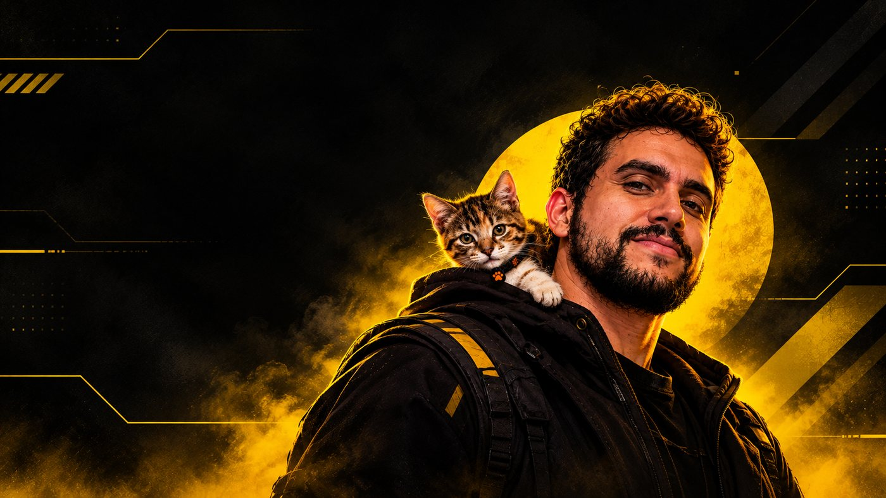

  

<h1 align="center">Bruno Lira</h1>

  <strong>Designer gráfico &amp; web</strong> · Brasília, DF (UTC−3) 
  Identidade visual, campanhas e sites — do impresso ao código.

  <a href="https://www.behance.net/brunolieps">Behance</a> ·
  <a href="https://www.linkedin.com/in/brunolieps">LinkedIn</a> ·
  <a href="mailto:bruno.oli.lira@gmail.com">E-mail</a>

Tenho seis anos de experiência em design gráfico, atuando com identidade visual, campanhas, web design e motion. Também escrevo front-end (HTML, CSS e JavaScript), o que me permite entregar a peça e a página sem repasse.

Já atendi clientes como Atacadão Dia a Dia, Hospital Anna Nery, Casa Vieira, Quallity Pró Saúde, DONA e Banda O Trevo.

## O que eu faço

- **Identidade visual** — marcas, rebrand e materiais gráficos.
- **Campanha** — peças online e offline, do conceito ao arquivo final.
- **Web** — sites em WordPress e front-end em HTML, CSS e JavaScript.
- **Motion** — animação e motion graphics em After Effects, além de edição de vídeo.

## Trajetória

Comecei como estagiário em design gráfico em 2019. Passei por NUUX, BeByte, Let's Go e Lancy — onde fiquei três anos — e depois pela Stud10, com game design e Godot Engine. Formação: Tecnólogo em Design Gráfico pela UDF (2018–2019).

## Projetos

**To Do List** · PWA de lista de tarefas em HTML, CSS e JavaScript puro, com temas claro e escuro, funcionamento offline e instalação na tela inicial.

[Demo](https://todo-list.bruno-oli-lira.workers.dev) · [Código](https://github.com/brunolieps/to-do-list)

**Habit Tracker** · App de hábitos para desktop e Android em Tauri 2, com front-end em HTML, CSS e JavaScript. Em desenvolvimento.

[Código](https://github.com/brunolieps/habit-tracker)

Mais em [behance.net/brunolieps](https://www.behance.net/brunolieps).

## Ferramentas

- **Design** · Illustrator, Photoshop, InDesign, Canva
- **Movimento** · After Effects e edição de vídeo
- **Web** · HTML, CSS, JavaScript, WordPress
- **Jogos** · Godot Engine

## Idiomas

Português nativo · Inglês avançado · Chinês básico

## Vamos conversar

Estou aberto a oportunidades remotas, híbridas ou presenciais em Brasília — e a projetos freelance.

[Behance](https://www.behance.net/brunolieps) · [LinkedIn](https://www.linkedin.com/in/brunolieps) · [bruno.oli.lira@gmail.com](mailto:bruno.oli.lira@gmail.com)

<strong>English</strong>

 

**Graphic &amp; web designer** based in Brasília, Brazil (UTC−3). Six years in agencies working on brand identity, campaigns, websites and motion. I also write front-end (HTML, CSS and JavaScript).

Clients include Atacadão Dia a Dia, Hospital Anna Nery and Casa Vieira. Tools: Illustrator, Photoshop, InDesign, After Effects, HTML, CSS, JavaScript, WordPress and Godot.

- **To Do List** — task list PWA in vanilla HTML, CSS and JavaScript.
- **Habit Tracker** — habit app for desktop and Android built with Tauri 2.

Open to remote, hybrid or on-site opportunities in Brasília — and to freelance projects.

[Portfolio](https://www.behance.net/brunolieps) · [LinkedIn](https://www.linkedin.com/in/brunolieps) · [Email](mailto:bruno.oli.lira@gmail.com)

<strong>Sobre este repositório</strong>

 

Este repositório é o código do meu site pessoal — feito à mão em HTML, CSS e JavaScript, sem framework.

- `index.html` — estrutura e conteúdo
- `stylesheet.css` — estilos
- `src/` — imagens

O site está em construção.

